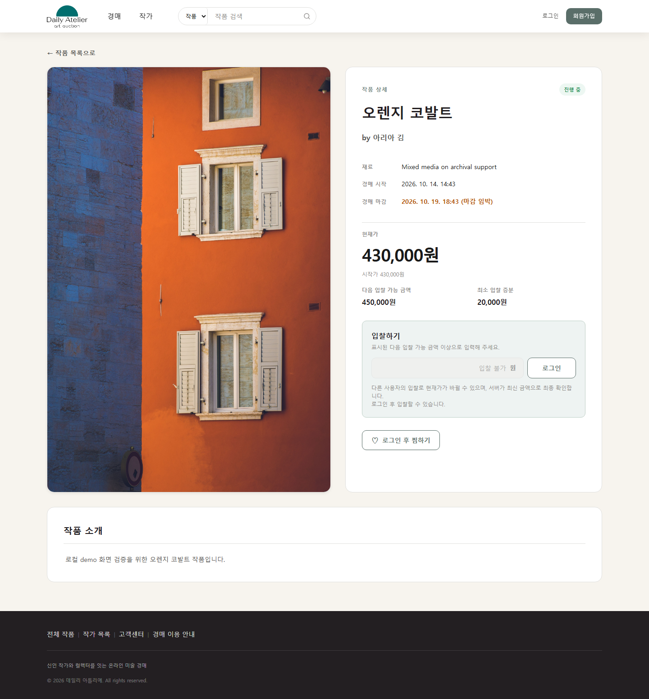
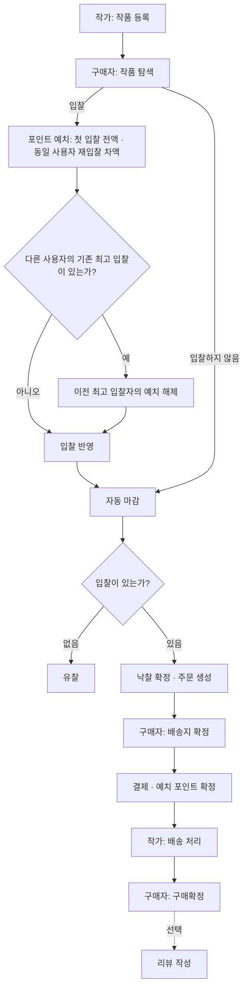

# DailyAtelier

신인 작가와 컬렉터를 연결하는 온라인 미술 경매 서비스입니다.

구매자는 작품 탐색부터 입찰·낙찰 결제·구매확정·리뷰까지 이용하고, 작가는 작품 등록부터 경매·판매 주문까지 관리합니다. React 프론트엔드와 Spring Boot 백엔드를 연결해 전체 거래 흐름을 구현했습니다.

백엔드에서는 **동시 입찰과 자동 마감의 경합, 포인트 거래의 정합성, 외부 이미지 삭제의 실패 처리**를 주요 과제로 다뤘습니다.

> 내부 데모 포인트로 동작하며 실제 PG 승인·취소와 배송사 위치 조회는 연동하지 않았습니다.

## 1. 대표 서비스 화면

작품 이미지, 경매 일정, 현재가와 다음 입찰 가능 금액을 확인할 수 있습니다. 로그인한 구매자는 입찰과 찜 기능을 이용합니다.



## 2. 주요 기능 및 거래 흐름

| 사용자 | 주요 기능 |
| --- | --- |
| 구매자 | 작품 검색·필터·정렬·찜, 포인트 충전, 입찰 현황, 낙찰 주문 결제, 구매확정·리뷰 |
| 작가 | 작품 등록·수정·삭제, 경매·판매 주문 관리, 배송·환불 처리 |
| 공통 | 회원가입·JWT 로그인, 프로필 관리, 1:1 문의 |
| 자동 처리 | 경매 마감·낙찰 주문 생성, 주문 만료 처리, 이미지 cleanup |



입찰·예치·이전 예치 해제는 하나의 트랜잭션으로 반영합니다. 입찰 금액은 즉시 소비하지 않고 예치하며 낙찰 주문 결제 시 확정합니다.

## 3. 핵심 기술 결정

| 해결할 문제 | 선택 기술 | 선택 이유 |
| --- | --- | --- |
| 동시 입찰·자동 마감의 경합 | JPA 비관적 락·트랜잭션 | 동일 작품의 거래를 직렬화하면서 가격·예치·낙찰 주문을 DB 트랜잭션으로 함께 보호하기 위해 |
| 포인트 중복 반영과 변경 근거 추적 | 계정 잠금·불변 원장·멱등성 키·unique 제약 | 잔액만으로 알 수 없는 거래 근거를 남기고 중복 반영을 제어하기 위해 |
| DB 변경과 외부 이미지 삭제의 부분 실패 | Cleanup outbox·lease·fencing | DB와 외부 저장소를 하나의 트랜잭션으로 묶을 수 없어 삭제 재시도와 worker 소유권 관리가 필요하기 때문에 |
| 비밀번호·권한 변경 뒤 기존 토큰 사용 | JWT authVersion·현재 DB 역할 재검증 | 토큰 만료를 기다리지 않고 변경 전 토큰을 무효화하며 현재 권한을 반영하기 위해 |

핵심 코드: [입찰](backend/src/main/java/com/dailyatelier/dailyatelier/service/BidService.java) · [마감](backend/src/main/java/com/dailyatelier/dailyatelier/service/AuctionCloseService.java) · [포인트 정합성](backend/src/main/java/com/dailyatelier/dailyatelier/service/PointLedgerConsistencyService.java) · [cleanup](backend/src/main/java/com/dailyatelier/dailyatelier/service/CloudinaryCleanupTransactionService.java) · [JWT 필터](backend/src/main/java/com/dailyatelier/dailyatelier/jwt/JwtAuthenticationFilter.java)

## 4. 기술 스택

| 영역 | 기술 | 역할 |
| --- | --- | --- |
| Backend | Java 17, Spring Boot 3.5 | 거래 규칙, REST API, scheduler와 worker |
| Security | Spring Security, JWT | 인증과 역할별 권한 분리 |
| Persistence | Spring Data JPA, MySQL 8 | 거래 저장, 비관적 락과 DB 제약 |
| Migration | Flyway | 기준 스키마와 변경 이력 관리 |
| Frontend | React 19, Vite, React Router, Axios | 경매·주문 UI와 비동기 상태 관리 |
| External | Cloudinary | 작품·프로필·문의 이미지 저장 |
| Test | JUnit, Spring Test, Vitest, Testing Library, k6 | 계약·동시성·UI 상태·부하 검증 |

## 5. 검증 요약 및 상세 문서

- 동시 입찰·거래 rollback·포인트 정합성을 검사하고, 별도 MySQL 환경에서 락·제약을 검증했습니다.
- JWT 작업에서 빈 DB V1→V11·기존 DB V10→V11 적용과 토큰 무효화 계약을 검증했습니다.
- k6로 작품·계정 경합을 로컬 단일 장비에서 관찰했습니다.

설계·테스트 근거 및 CI 실행 범위는 [기술 설계와 검증](docs/TECHNICAL.md)에서 확인할 수 있습니다. CI의 스크린샷은 캡처·artifact 보관이며 자동 시각 평가가 아닙니다.

[Flyway 안내](backend/FLYWAY.md) · [BACKLOG](BACKLOG.md)

## 6. 로컬 실행

### 사전 준비

- JDK 17
- MySQL 8
- Node.js `^20.19.0 || >=22.12.0`
- npm
- 작품 및 문의 첨부 이미지 업로드용 Cloudinary 계정

### MySQL 준비

비어 있는 스키마를 만듭니다. 애플리케이션을 처음 실행하면 Flyway가 V1~V11 migration을 순서대로 적용하고, Hibernate는 `ddl-auto=validate`로 결과만 검증합니다.

```sql
CREATE DATABASE dailyatelier
  CHARACTER SET utf8mb4
  COLLATE utf8mb4_unicode_ci;
```

기존 DB에도 미적용 Flyway migration은 실행됩니다. DB나 스키마를 자동 삭제하지 않습니다. 기존 DB 처리와 격리 MySQL 검증 원칙은 [backend/FLYWAY.md](backend/FLYWAY.md)를 참고하세요.

### 환경변수

예제 파일을 복사합니다.

Windows PowerShell:

```powershell
Copy-Item backend/daliyatelier.env.example backend/daliyatelier.env
```

macOS/Linux:

```bash
cp backend/daliyatelier.env.example backend/daliyatelier.env
```

`backend/daliyatelier.env`의 값을 로컬 환경에 맞게 바꿉니다.

| 변수 | 용도 |
| --- | --- |
| `DB_URL` | MySQL JDBC URL |
| `DB_USERNAME` | MySQL 사용자 |
| `DB_PASSWORD` | MySQL 비밀번호 |
| `JWT_SECRET` | JWT 서명 키. 임의의 충분히 긴 비밀값 사용 |
| `CLOUDINARY_CLOUD_NAME` | Cloudinary cloud name |
| `CLOUDINARY_API_KEY` | Cloudinary API key |
| `CLOUDINARY_API_SECRET` | Cloudinary API secret |
| `CORS_ALLOWED_ORIGINS` | 허용할 프론트 origin |

`daliyatelier.env`는 현재 프로젝트가 실제로 사용하는 파일명입니다. 철자를 바꾸지 마세요. 실제 파일과 비밀값은 Git에서 제외되며, 예제 값은 개발 또는 운영 비밀값으로 사용하면 안 됩니다.

여러 프론트 주소를 허용할 때는 공백 없이 쉼표로 구분합니다.

```properties
CORS_ALLOWED_ORIGINS=http://localhost:5173,https://portfolio.example.com
```

credentials를 사용하는 CORS 설정이므로 `*`는 허용되지 않습니다.

프론트는 기본적으로 `http://localhost:8080`을 API 주소로 사용합니다. 다른 주소가 필요하면 예제 파일을 복사해 값을 바꿉니다.

Windows PowerShell:

```powershell
Copy-Item frontend/.env.example frontend/.env
```

macOS/Linux:

```bash
cp frontend/.env.example frontend/.env
```

```properties
VITE_API_BASE_URL=http://localhost:8080
```

`VITE_API_BASE_URL`은 Vite build 시점에 번들에 포함됩니다. 배포 주소를 바꾸면 프론트를 다시 빌드해야 하며, 백엔드의 `CORS_ALLOWED_ORIGINS`에도 프론트 origin을 함께 추가해야 합니다.

### 실행

두 터미널에서 백엔드와 프론트를 각각 실행합니다. 백엔드는 상대 경로 환경파일을 읽으므로 반드시 `backend` 디렉터리에서 시작합니다.

터미널 1 — 백엔드:

```powershell
cd backend
.\gradlew.bat bootRun
```

macOS/Linux에서는 다음 명령을 사용합니다.

```bash
cd backend
./gradlew bootRun
```

터미널 2 — 프론트:

```bash
cd frontend
npm ci
npm run dev
```

- Frontend: `http://localhost:5173`
- Backend: `http://localhost:8080`
- 기본 API: `GET http://localhost:8080/api/arts`
